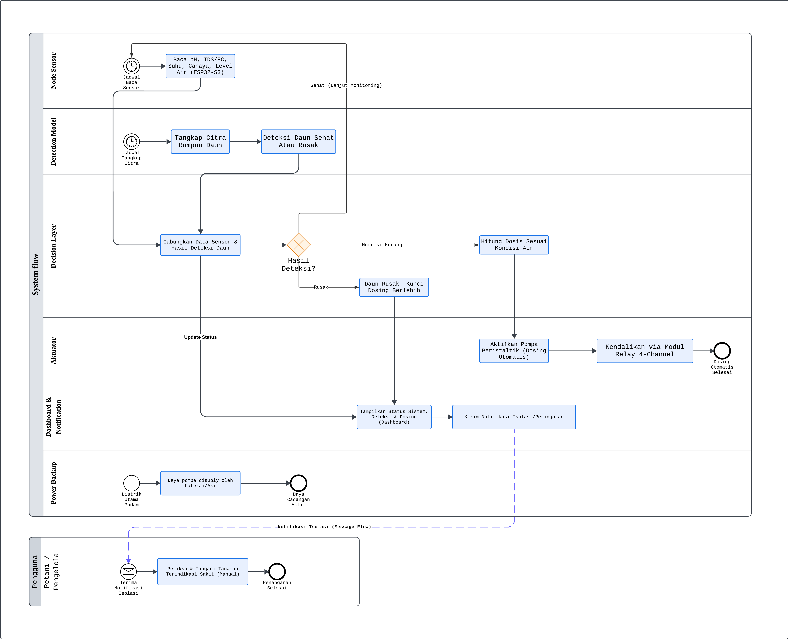
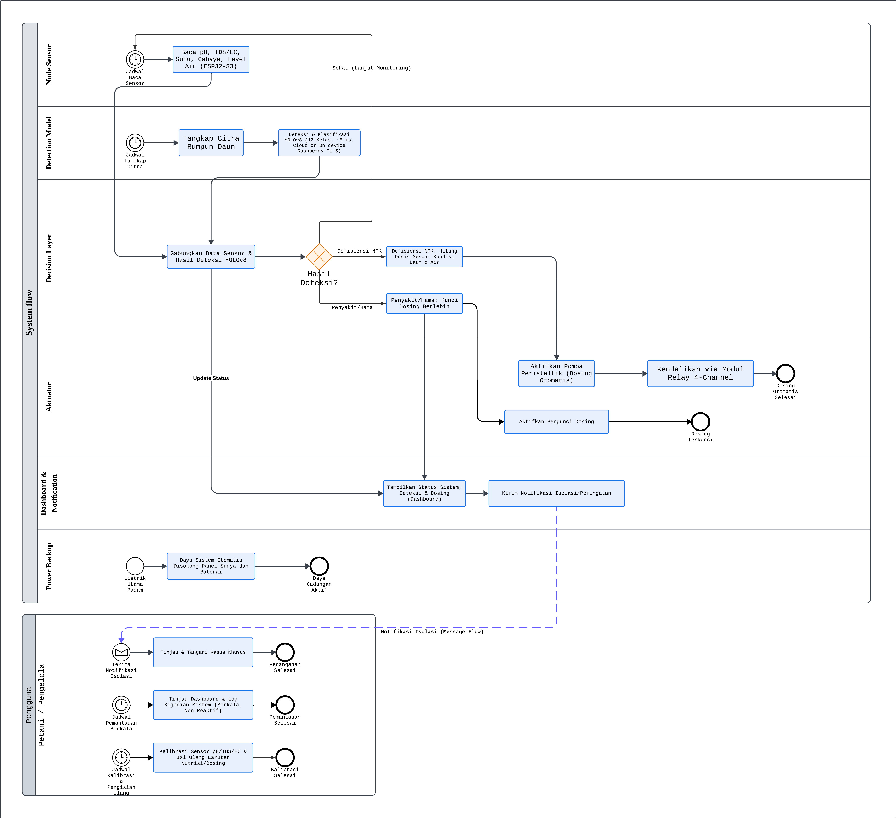
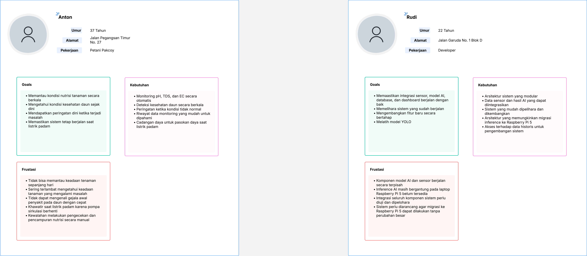
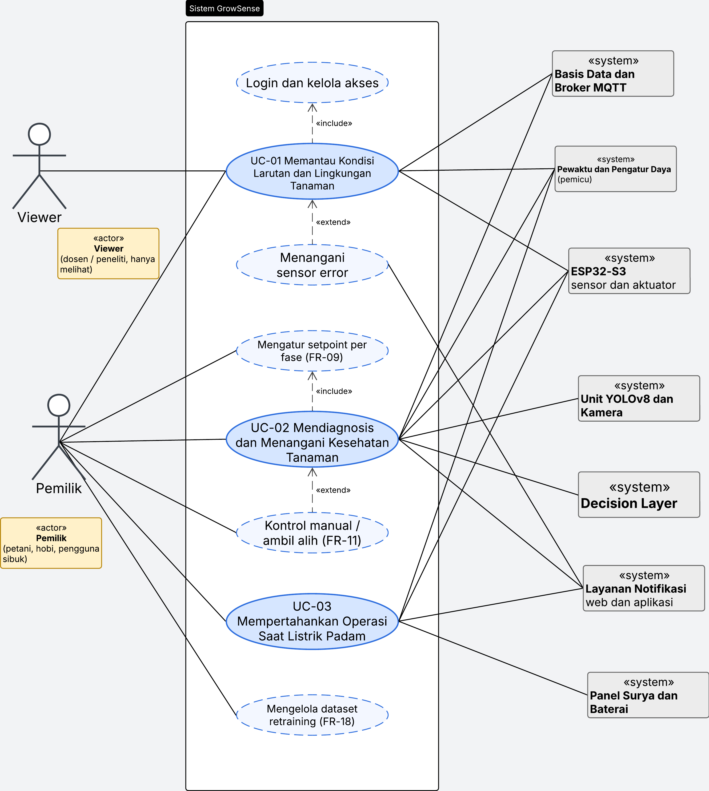
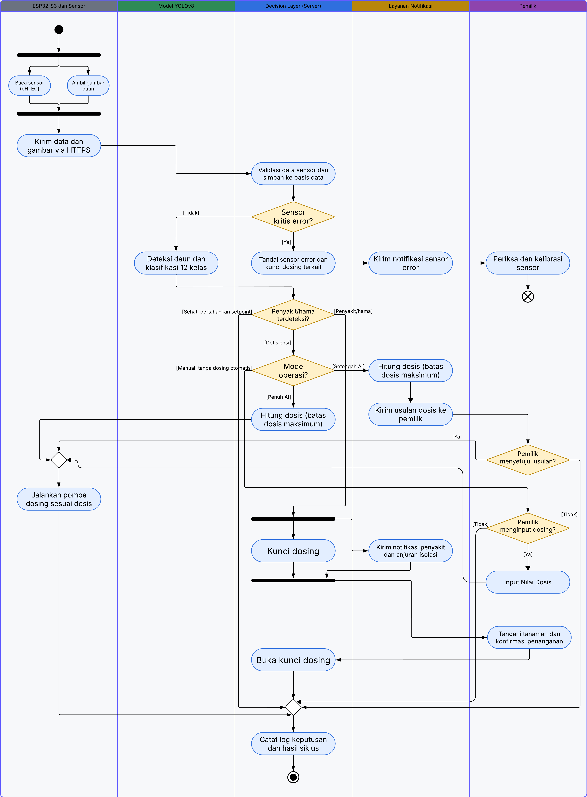
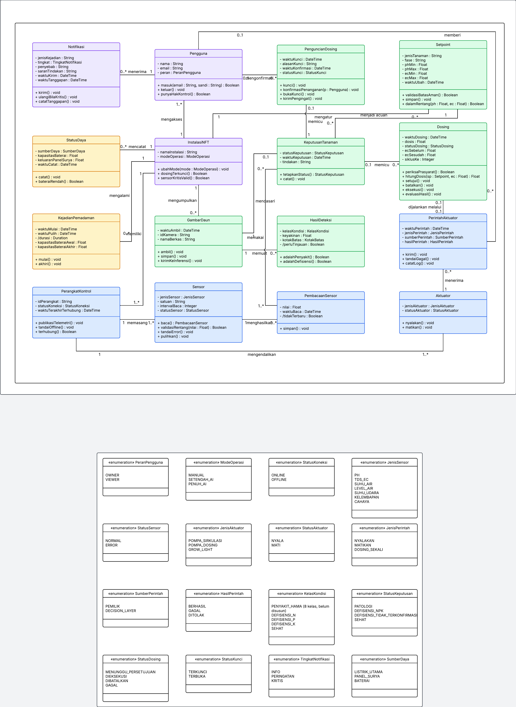

# 3 Analisis dan Perancangan Sistem

## 3.1 Diagram BPMN

### 3.1.1 BPMN AS-IS

Diagram BPMN AS-IS menggambarkan sistem hidroponik yang sudah ada sebagai pembanding bagi GrowSense. Diagram terdiri dari dua pool. Pool _System flow_ memuat enam lane: Node Sensor, Detection Model, Decision Layer, Aktuator, Dashboard & Notification, dan Power Backup. Pool _Pengguna_ memuat peran Petani/Pengelola. Dua proses berjalan paralel berdasarkan pewaktu: node ESP32-S3 membaca pH, TDS/EC, suhu, cahaya, dan level air, sementara model deteksi menangkap citra rumpun daun dan hanya menentukan apakah daun sehat atau rusak.

Decision Layer menggabungkan data sensor dengan hasil deteksi daun, lalu gateway eksklusif "Hasil Deteksi?" mengarahkan alur. Bila tanaman sehat, sistem melanjutkan pemantauan dengan kembali ke pembacaan sensor. Bila nutrisi kurang, sistem menghitung dosis sesuai kondisi air, lalu mengaktifkan pompa peristaltik melalui modul relay 4-channel. Bila daun rusak, dosing dikunci agar tidak berlebih, status ditampilkan pada dashboard, dan notifikasi isolasi atau peringatan dikirim.

Notifikasi isolasi mengalir sebagai _message flow_ ke pool Pengguna, dan penanganan tanaman yang terindikasi sakit dilakukan secara manual oleh petani atau pengelola. Lane Power Backup menunjukkan bahwa saat listrik padam, daya pompa disuplai oleh baterai atau aki. Pembanding utama terhadap TO-BE ada pada tingkat rincian deteksi (hanya sehat atau rusak, tanpa membedakan penyakit, hama, dan defisiensi), dosis yang hanya mempertimbangkan kondisi air, sumber daya cadangan (baterai atau aki), dan peran pengguna yang menangani tanaman sakit sepenuhnya secara manual.

### 3.1.2 BPMN TO-BE

Diagram BPMN TO-BE memakai struktur pool dan lane yang sama dengan AS-IS sehingga perbedaannya mudah dibandingkan. Alur utamanya tetap pembacaan sensor, deteksi daun, penggabungan data oleh Decision Layer, dan percabangan berdasarkan hasil deteksi. Perbedaan pertama ada pada lane Detection Model: deteksi tidak lagi hanya membedakan sehat atau rusak, tetapi mengklasifikasikan daun ke 12 kelas dengan YOLOv8 (sekitar 5 ms), dengan inferensi di cloud atau langsung pada Raspberry Pi 5 sesuai arah migrasi ke perangkat edge.

Perbedaan kedua ada pada penanganan penyakit atau hama. Decision Layer mengunci dosing melalui aktivitas "Aktifkan Pengunci Dosing" pada lane Aktuator, status ditampilkan pada dashboard, dan notifikasi anjuran isolasi dikirim kepada pemilik, yang kemudian menangani tanaman. Perbedaan ketiga ada pada lane Power Backup: saat listrik utama padam, seluruh sistem disokong panel surya dan baterai secara otomatis, tidak lagi hanya baterai atau aki.

Perbedaan keempat ada pada pool Pengguna, yang kini memuat tiga rutinitas: menerima notifikasi isolasi lalu menangani kasus khusus, meninjau dashboard dan log kejadian secara berkala (non-reaktif), serta kalibrasi sensor pH/TDS/EC dan pengisian ulang larutan nutrisi secara terjadwal. Perubahan ini sejalan dengan tujuan sistem agar pemilik bertindak terutama saat ada notifikasi dan tidak perlu memeriksa kondisi tanaman setiap saat.

## 3.2 User Persona

Dua persona dipakai untuk mewakili pengguna dan pengembang sistem. Persona pertama adalah Anton (37 tahun), petani pakcoy yang mewakili pengguna utama. Tujuannya memantau kondisi nutrisi dan kesehatan daun secara berkala, mendapat peringatan dini, serta memastikan sistem tetap berjalan saat listrik padam. Kebutuhannya meliputi monitoring pH, TDS, dan EC otomatis, deteksi kesehatan daun berkala, peringatan saat kondisi tidak normal, riwayat data yang mudah dipahami, dan cadangan daya.

Frustrasi Anton menjadi dasar kebutuhan sistem: ia tidak bisa memantau tanaman sepanjang hari, sering terlambat mengetahui masalah, sulit mengenali gejala awal penyakit pada daun, khawatir pompa sirkulasi berhenti saat listrik padam, dan kewalahan melakukan pengecekan serta pencampuran nutrisi secara manual. Frustrasi ini sejalan dengan kebutuhan pengguna UN-01 sampai UN-04 dan UN-06 pada SRS Lampiran A.

Persona kedua adalah Rudi (22 tahun), developer yang mewakili pihak pemelihara dan pengembang sistem. Tujuannya memastikan integrasi sensor, model AI, basis data, dan dashboard berjalan baik, serta mengembangkan fitur baru secara bertahap. Kebutuhannya mencakup arsitektur modular yang mudah dipelihara, data sensor dan hasil AI yang dapat diintegrasikan, arsitektur yang memungkinkan migrasi inferensi ke Raspberry Pi 5, dan akses ke data historis. Kebutuhan ini tercermin pada SCA-03, MNT-01 sampai MNT-07, FR-14, dan FR-18.

## 3.3 Software Requirement Specification (SRS)

SRS GrowSense versi 1.3 disusun mengikuti struktur dokumen kebutuhan perangkat lunak: pendahuluan (lingkup, nilai produk, pembaca, penggunaan, deskripsi umum), kebutuhan fungsional, antarmuka eksternal, kebutuhan nonfungsional, definisi, serta tiga lampiran. Bagian kebutuhan fungsional memuat 20 kebutuhan (FR-01 sampai FR-20), yaitu 17 berprioritas Must, 1 Should, dan 2 Could menurut skema MoSCoW. Setiap kebutuhan memiliki deskripsi, pemicu, proses, keluaran, batasan, dan kriteria penerimaan yang dapat diuji.

Kebutuhan nonfungsional berjumlah 45 butir dalam delapan kategori (keamanan, kapasitas, kompatibilitas, keandalan, skalabilitas, pemeliharaan, kegunaan, dan lainnya), masing-masing dengan nilai terukur dan cara verifikasi. Lampiran A berisi RTM dari kebutuhan pengguna sampai test case, Lampiran B berisi prosedur Change Request, dan Lampiran C berisi daftar asumsi dan nilai usulan yang perlu divalidasi. Dokumen lengkap tercantum pada Lampiran 1 dan tersedia pada berkas `Dokumen/SRS.md` di repositori.

## 3.4 Diagram UML

### 3.4.1 Use Case Diagram

Use Case Diagram menggambarkan batas sistem GrowSense, aktor, dan hubungan antar-use case. Aktor manusia ada dua: Pemilik (Owner), yang mencakup petani, penggiat hobi, dan pengguna sibuk, serta Viewer (dosen atau peneliti) yang hanya dapat melihat. Di sisi kanan terdapat tujuh aktor sistem: basis data dan broker MQTT, pewaktu dan pengatur daya (pemicu), ESP32-S3 beserta sensor dan aktuator, unit YOLOv8 dan kamera, Decision Layer, layanan notifikasi, serta panel surya dan baterai.

Tiga use case utama (berwarna biru tua) adalah UC-01 Memantau Kondisi Larutan dan Lingkungan Tanaman, UC-02 Mendiagnosis dan Menangani Kesehatan Tanaman, dan UC-03 Mempertahankan Operasi Saat Listrik Padam. Viewer hanya terhubung ke UC-01, sedangkan Pemilik terhubung ke ketiga use case utama dan ke use case pendukung seperti pengaturan setpoint, kontrol manual, dan pengelolaan dataset.

Use case pendukung dihubungkan dengan relasi UML. UC-01 meng-_include_ "Login dan kelola akses" dan di-_extend_ oleh "Menangani sensor error". UC-02 meng-_include_ "Mengatur setpoint per fase" (FR-09) dan di-_extend_ oleh "Kontrol manual / ambil alih" (FR-11). "Mengelola dataset retraining" (FR-18) berdiri sebagai fungsi pendukung. Aktor sistem terhubung ke use case sesuai perannya: misalnya unit YOLOv8, kamera, dan Decision Layer hanya terhubung ke UC-02, sedangkan panel surya dan baterai hanya terhubung ke UC-03.

### 3.4.2 Activity Diagram

Activity Diagram memodelkan satu siklus pemantauan dan penanganan dengan lima swimlane: ESP32-S3 dan Sensor, Model YOLOv8, Decision Layer (Server), Layanan Notifikasi, dan Pemilik. Alur dimulai dengan _fork_ yang menjalankan pembacaan sensor (pH, EC) dan pengambilan gambar daun secara paralel, lalu digabung (_join_) dan dikirim melalui HTTPS. Server memvalidasi data, menyimpannya ke basis data, dan memeriksa apakah sensor kritis error.

Bila sensor kritis error, sistem menandai sensor, mengunci dosing yang terkait, mengirim notifikasi, dan pemilik memeriksa serta mengkalibrasi sensor; alur berakhir pada _activity final_. Bila tidak, model YOLOv8 mendeteksi dan mengklasifikasikan daun ke 12 kelas, lalu Decision Layer memilih satu dari tiga cabang. Cabang sehat mempertahankan setpoint. Cabang penyakit atau hama menjalankan _fork_: dosing dikunci sambil notifikasi penyakit dan anjuran isolasi dikirim, lalu pemilik menangani tanaman dan mengonfirmasi, dan dosing dibuka kembali.

Cabang defisiensi bergantung pada mode operasi. Pada mode Penuh AI, sistem menghitung dosis dengan batas dosis maksimum lalu pompa dosing dijalankan. Pada mode Setengah AI, sistem juga menghitung dosis dengan batas maksimum, lalu mengirim usulan dosis ke pemilik, dan dosing hanya berjalan bila pemilik menyetujui. Pada mode Manual, tidak ada dosing otomatis, dan dosing hanya berjalan bila pemilik menginput nilai dosis sendiri. Seluruh cabang bertemu pada pencatatan log keputusan dan hasil siklus sebelum alur berakhir. Diagram ini menyederhanakan beberapa hal yang dirinci pada Use Case Specification, seperti kamera sebagai lane tersendiri, siklus sensor dan siklus gambar yang berbeda interval, serta cabang keyakinan deteksi rendah.

### 3.4.3 Class Diagram

Class Diagram domain memuat 16 kelas dan 16 enumerasi. Kelas dikelompokkan dengan warna: ungu untuk inti pengguna dan instalasi (Pengguna, InstalasiNFT, Notifikasi), hijau untuk keputusan dan AI (GambarDaun, HasilDeteksi, KeputusanTanaman, Dosing, PenguncianDosing, Setpoint), oranye untuk daya (StatusDaya, KejadianPemadaman), dan biru untuk perangkat (PerangkatKontrol, Sensor, PembacaanSensor, PerintahAktuator, Aktuator). Setiap kelas menampilkan atribut beserta tipenya dan operasinya, sedangkan enumerasi ditampilkan pada panel tersendiri di bawah diagram.

Hubungan antarkelas mengikuti alur sistem. Pengguna mengakses InstalasiNFT dan menerima Notifikasi. InstalasiNFT mengumpulkan GambarDaun, yang memuat HasilDeteksi, dan hasil tersebut mendasari KeputusanTanaman. KeputusanTanaman memicu Dosing dan PenguncianDosing, sedangkan Setpoint menjadi acuan dosis. Dosing dijalankan melalui PerintahAktuator yang diterima Aktuator. PerangkatKontrol memasang Sensor, Sensor menghasilkan PembacaanSensor, dan PerangkatKontrol mengendalikan Aktuator. Multiplisitas pada tiap asosiasi dicantumkan pada diagram.

Enumerasi memastikan nilai yang konsisten dengan SRS, misalnya StatusKeputusan (PATOLOGI, DEFISIENSI_NPK, DEFISIENSI_TIDAK_TERKONFIRMASI, SEHAT), ModeOperasi (MANUAL, SETENGAH_AI, PENUH_AI), PeranPengguna (OWNER, VIEWER), TingkatNotifikasi (INFO, PERINGATAN, KRITIS), dan SumberDaya (LISTRIK_UTAMA, PANEL_SURYA, BATERAI). Kelas KelasKondisi mencantumkan delapan kelas penyakit atau hama sebagai satu kategori karena daftar rincinya masih disusun.

## 3.5 Use Case Specification dan RTM

Use Case Specification memakai Basic Use Case Template milik Cockburn dan memuat tiga use case utama (UC-01 sampai UC-03), masing-masing dengan tujuan, prasyarat, kondisi sukses dan gagal, skenario utama, ekstensi, sub-variasi, informasi terkait, dan isu terbuka. Tiga use case dipilih karena mewakili hal yang membedakan GrowSense: data sensor tepercaya, diagnosis kesehatan tanaman dengan dosing adaptif, dan ketahanan terhadap pemadaman. Dokumen lengkap tercantum pada Lampiran 2 dan tersedia pada berkas `Dokumen/Use_Case_Specification.md`.

RTM menghubungkan kebutuhan fungsional ke use case dan konsep domain pada Class Diagram, sehingga setiap kebutuhan dapat ditelusuri ke rancangan dan setiap kelas domain memiliki alasan keberadaan. Ketertelusuran dari kebutuhan pengguna sampai test case terdapat pada SRS Lampiran A. Dokumen RTM tercantum pada Lampiran 3 dan tersedia pada berkas `Dokumen/RTM.md`.

## 3.6 Repositori GitHub

Seluruh diagram dan dokumen diunggah ke repositori GitHub kelompok:

https://github.com/sryy-raphaell/GrowSense

Struktur repositori mengikuti ketentuan tugas: folder `Diagram` (BPMN AS-IS dan TO-BE, User Persona, UML), folder `Dokumen` (SRS, Use Case Specification, RTM), dan `README.md` berisi identitas kelompok serta ringkasan aplikasi.
